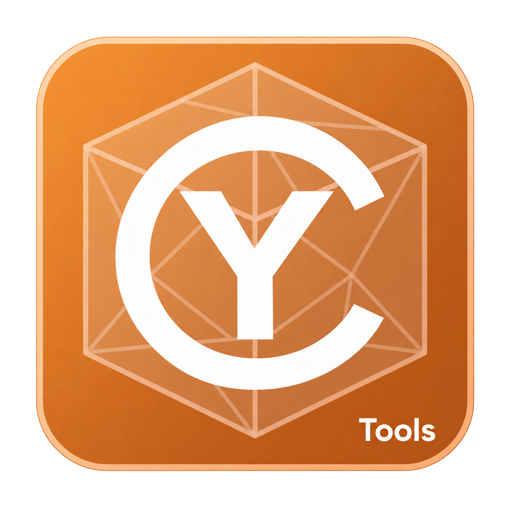
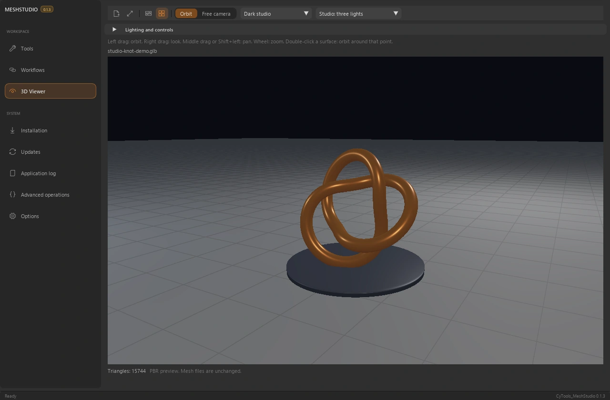
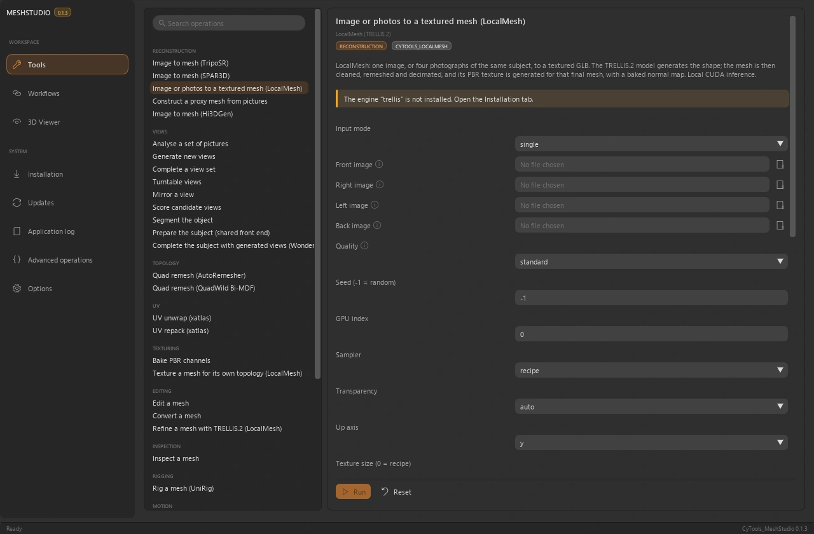
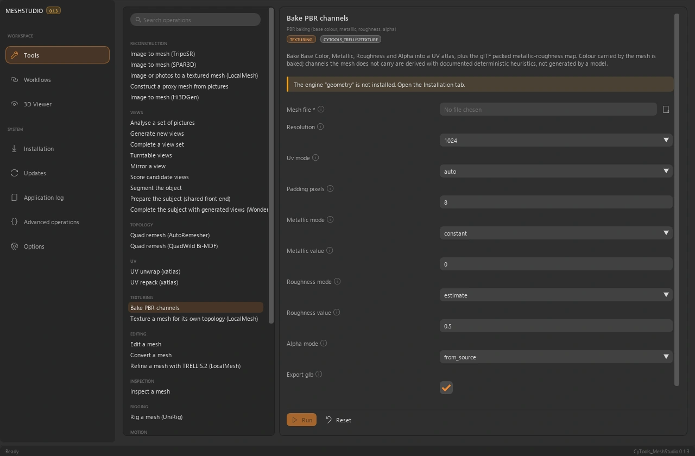

<table width="100%">
  <tr>
    <td width="300" align="left" valign="top">
      <a href="https://mrmybal.github.io/CyTools_MeshStudio/?lang=fr">Site web</a><br>
      <a href="https://mrmybal.github.io/CyTools_MeshStudio/Documentation.html#/fr/overview">Documentation</a><br>
      <a href="https://github.com/MrMybal/CyTools_MeshStudio">GitHub</a><br><br>
      <sub>README</sub><br>
      <a href="README.md">English</a> · <a href="README.fr.md">Français</a>
    </td>
    <td width="400" align="center" valign="middle">
      <a href="https://mrmybal.github.io/CyTools_MeshStudio/?lang=fr"></a>
    </td>
    <td width="300" align="right" valign="top">
      <p><sub>Licence de l’application</sub><br><a href="LICENSE"><strong>GPL-3.0-only</strong></a></p>
      <p><sub>Version de l’application</sub><br><a href="VERSION.fr.md"><strong>0.1.4</strong></a><br><strong>EXPÉRIMENTAL</strong></p>
      <p><a href="https://github.com/MrMybal/CyTools_MeshStudio/releases/download/v0.1.4/CyTools_MeshStudio-0.1.4-windows-x64.zip"><strong>Télécharger</strong></a><br><sub>Windows x64 · portable</sub></p>
    </td>
  </tr>
</table>

<h1 align="center">CyTools MeshStudio</h1>

Maintenance : **Cyberalien**.


Reconstruisez, inspectez et traitez les maillages dans une même application. Choisissez un moteur compatible, préparez les vues et poursuivez avec la topologie, les UV ou les matériaux. Pour les artistes 3D et les créateurs techniques qui veulent inspecter les résultats et combiner les opérations de maillage.

> **EXPÉRIMENTAL · 0.1.4**
>
> Version Windows publiée pour évaluation ; certains parcours des moteurs restent à valider. Consultez les [notes de version et limites connues](VERSION.fr.md).

[](website/assets/showcase/viewer.webp)

*Visualiseur interactif · maillage procédural de démonstration, pas une reconstruction IA.*


## L’application

### Reconstruction

Les parcours de reconstruction incluent TripoSR, SPAR3D et LocalMesh / TRELLIS.2. Chaque moteur possède son installation, ses paramètres et ses conditions d’accès. Préparez ou validez les vues avant un workflow plus complet.

[](website/assets/showcase/reconstruction.webp)

*Espace de reconstruction · paramètres de l’opération et choix du moteur.*


### Inspecter le résultat

Inspectez les résultats dans le viewport 3D intégré. Passez de l’orbite à la caméra libre, rapprochez-vous de la surface et changez la scène ou l’éclairage pour examiner le résultat.

### Topologie et matériaux

Lancez le remeshing, les UV et le PBR avec leurs réglages réels. Le baking expose résolution, canaux et export. Les outils de rigging et de mouvement utilisent des moteurs et prérequis distincts.

[](website/assets/showcase/pbr.webp)

*Formulaire PBR · taille des textures, gestion des UV et canaux de matériaux.*


## Fonctionnalités

- **Reconstruction :** TripoSR, SPAR3D, LocalMesh/TRELLIS.2 et autres moteurs déclarés, chacun avec ses modèles et limites de validation.
- **Géométrie :** parcours AutoRemesher/QuadWild, inspection, édition, conversion et opérations de dépliage/réorganisation des UV.
- **Matériaux et vues :** baking PBR, réglages de textures, préparation des vues et validation multivue.
- **Inspection des résultats :** visualiseur 3D intégré, caméra orbitale/libre, observation rapprochée, scènes et éclairage studio.
- **Workflows composables :** chaînes enregistrées et accès CLI/MCP. Les moteurs facultatifs de rigging, mouvement et raffinement ont leurs prérequis ; tous les parcours ne sont pas validés de bout en bout.

**Application et automatisation :** l’anglais est la langue par défaut ; le français se choisit dans Options. Enregistrez/chargez les configurations, consultez les journaux copiables et utilisez les opérations déclarées par CLI ou MCP. Le [manuel](https://mrmybal.github.io/CyTools_MeshStudio/Documentation.html#/fr/overview) décrit les paramètres et contrats de sortie réels.

---

## Installation

La version applicative publiée est pour **Windows x64**. Le ZIP portable inclut son Python privé et les dépendances de base de l’interface et des médias. Les modèles et moteurs lourds facultatifs se téléchargent séparément.

1. [Téléchargez CyTools MeshStudio 0.1.4](https://github.com/MrMybal/CyTools_MeshStudio/releases/download/v0.1.4/CyTools_MeshStudio-0.1.4-windows-x64.zip).
2. Extrayez le ZIP complet dans un dossier accessible en écriture. Gardez `app/` et `runtime/` à côté du lanceur.
3. Lancez **CyTools_MeshStudio.exe**. Utilisez l’espace d’installation/modèles pour les composants nécessaires ; consultez leurs licences et conditions d’accès avant le téléchargement.

Aucun Python système n’est nécessaire pour ouvrir le portable. L’installation depuis les sources et certains moteurs facultatifs nécessitent des outils supplémentaires comme Git. Conservez le dossier complet ; l’exécutable seul ou le ZIP de mise à jour `app` ne constitue pas une installation complète.

Expérimental, testé sous Windows avec du matériel NVIDIA. Linux n’est pas validé. Tous les moteurs installés n’ont pas été exécutés de bout en bout : l’inférence GPU Hi3DGen, certains parcours LocalMesh+ et le raffinement haute résolution restent à valider. WHAM nécessite les fichiers SMPL sous licence distincte. Les licences et accès varient selon le modèle.

### Mises à jour et données

Pour une installation compatible existante, utilisez Mises à jour et le paquet applicatif correspondant. Préservez `data/`, les moteurs et les modèles. Ne forcez pas une mise à jour destinée à un autre ABI. Si le runtime requis change, installez le portable complet dans un dossier séparé et suivez la migration.

## Sources, compilation et bibliothèques nécessaires

<details>
<summary>Installation des sources Windows et outils de compilation facultatifs</summary>


Utilisez Python **3.12** pour l’environnement de base depuis les sources. Git sert au clonage et aux dépendances Git épinglées. Compiler le lanceur nécessite les Build Tools MSVC x64 et une invite développeur.

```powershell
git clone https://github.com/MrMybal/CyTools_MeshStudio.git
cd CyTools_MeshStudio
py -3.12 -m venv runtime\python
runtime\python\Scripts\python.exe -m pip install -r app\requirements.txt
powershell -File app\build_launcher.ps1
.\CyTools_MeshStudio.exe
```

Les dépendances de base exactes sont dans [app/requirements.txt](app/requirements.txt). Les moteurs utilisent leurs propres environnements et catalogues ; installer la base ne les installe pas. Consultez le [guide développeur](app/README.md) pour la compilation détaillée et les composants facultatifs.

Une installation source nécessite aussi le moteur géométrique et les exécutables AutoRemesher/QuadWild, déjà inclus dans le portable. La page Installation prépare séparément les autres moteurs. Les environnements restent liés à leur chemin d’installation.

</details>

---

## Licence

**CyTools MeshStudio utilise la licence [GPL-3.0-only](LICENSE).** CyToolsCore, CyUI et CyDoc restent des composants MIT ; leurs licences ne changent pas celle de l’application. Moteurs, plugins et poids conservent leurs propres conditions.

### Principaux composants et bibliothèques tierces

| Bibliothèque · sources | Licence · texte | Utilisation / périmètre |
| --- | --- | --- |
| [CyToolsCore 0.10.1](https://github.com/MrMybal/CyToolsCore) | [MIT](LICENCES/CyToolsCore-MIT.txt) | SDK/runtime : jobs, sessions, ressources, CLI et MCP. |
| [CyUI 1.2.0](https://github.com/MrMybal/CyUI) | [MIT](LICENCES/CyUI-MIT.txt) | Modules Python d’interface sélectionnés et inclus. |
| [CyDoc 0.1.0](https://github.com/MrMybal/CyDoc) | [MIT](LICENCES/CyDoc-MIT.txt) | Lecteur local inclus ; Node/npm servent uniquement à la rédaction/génération. |
| [Dear ImGui / imgui-bundle](https://github.com/pthom/imgui_bundle) | [MIT + notices des composants](https://github.com/pthom/imgui_bundle/blob/main/LICENSE) | Rendu de l’interface et composants natifs inclus. |
| [CPython 3.12](https://www.python.org/) | [PSF + notices des composants](LICENCES/Python-3.12-PSF.txt) | Runtime privé inclus dans l’archive Windows portable. |
| [ModernGL / trimesh](app/requirements.txt) | [MIT](LICENCES/SOURCES.txt) | Gestion des maillages et aperçu OpenGL de base. |
| [AutoRemesher 1.2.0](https://github.com/huxingyi/autoremesher) | [MIT](LICENCES/AutoRemesher-MIT.txt) | Programme natif de géométrie du portable Windows. |
| [QuadWild Bi-MDF](https://github.com/cgg-bern/quadwild-bimdf) | [GPL-3.0](LICENCES/QuadWild-BiMDF-GPL-3.0.txt) | Programme natif de remeshing en quads ; Qt conserve ses conditions LGPL. |
| [Qt](https://www.qt.io/) | [LGPL-3.0](LICENCES/Qt-LGPL-3.0.txt) | Composant de la distribution native de géométrie. |
| [uv](https://github.com/astral-sh/uv) | [MIT OR Apache-2.0](LICENCES/uv-MIT.txt) | Utilitaire d’environnement/installation inclus ; la notice Apache alternative est conservée. |
| [Reconstruction / rigging / motion engines](app/engines.json) | [Conditions propres aux moteurs et modèles](app/licenses.json) | Téléchargés séparément ; conditions Stability, non commerciales et SMPL possibles. |

Ce tableau indexe les principaux composants sans remplacer leurs notices transitives complètes. Conservez [LICENCES/](LICENCES/), [app/licenses.json](app/licenses.json), les licences des paquets installés et celles de chaque moteur/modèle facultatif. Les bibliothèques CUDA installées conservent aussi les conditions NVIDIA.

## Références et liens

- [Documentation](https://mrmybal.github.io/CyTools_MeshStudio/Documentation.html#/fr/overview)
- [Site web](https://mrmybal.github.io/CyTools_MeshStudio/?lang=fr)
- [Dépôt des sources](https://github.com/MrMybal/CyTools_MeshStudio) · [Releases et sommes de contrôle](https://github.com/MrMybal/CyTools_MeshStudio/releases)
- [Suivi des problèmes](https://github.com/MrMybal/CyTools_MeshStudio/issues) · [Notes de version](VERSION.fr.md)
- [Guide développeur](app/README.md)

<details>
<summary><strong>AI Usage</strong></summary>

- [Commencer ici : guide IA du projet](app/AGENTS.md) — règles du produit et fichiers importants.
- [Opérations et intégration IA](app/Documentation/DocAI.md) — contrats réels et utilisation en tâches.
- [Compiler cette application](app/README.md) — installation des sources et commandes propres au produit.

</details>
