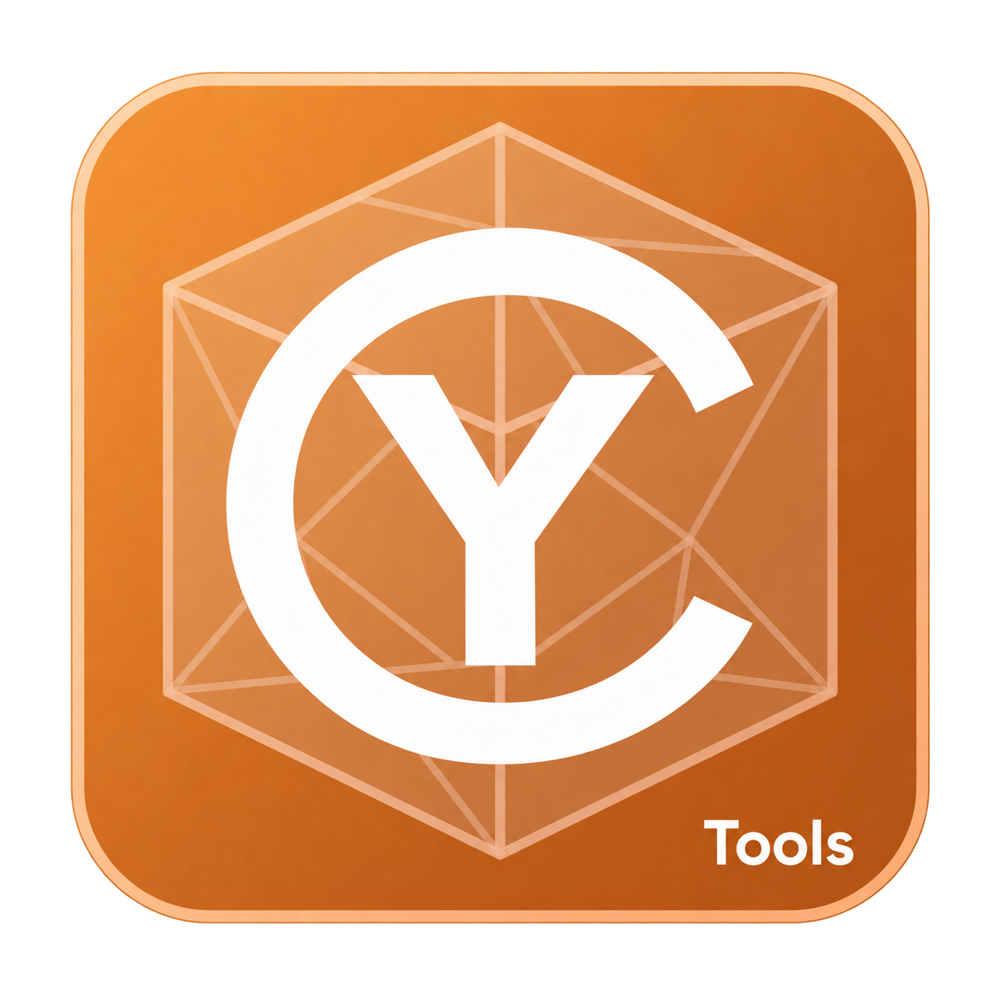
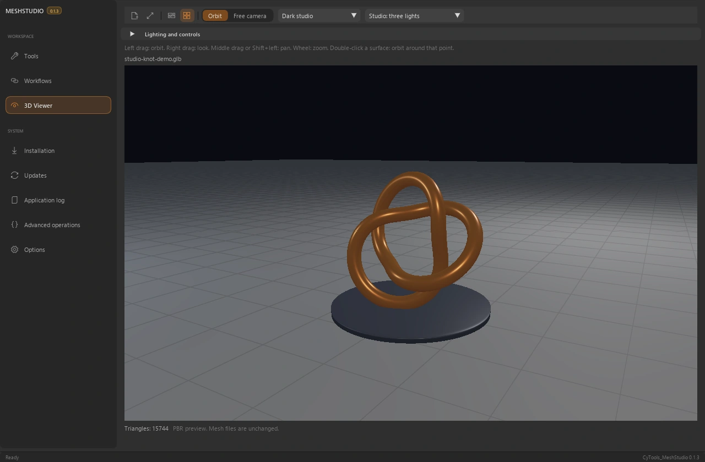
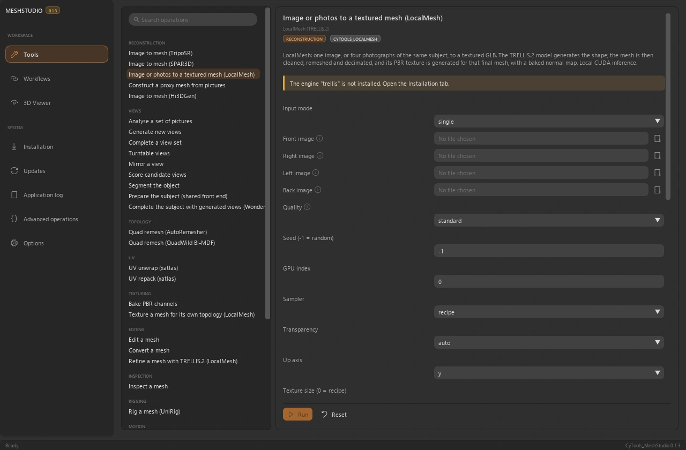
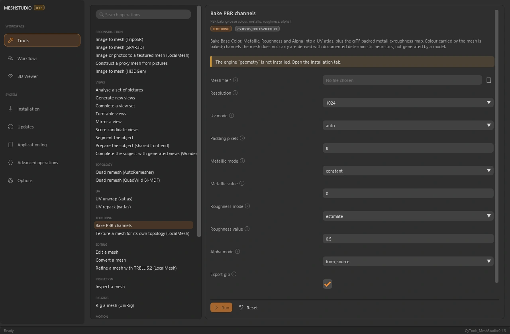

<table width="100%">
  <tr>
    <td width="300" align="left" valign="top">
      <a href="https://mrmybal.github.io/CyTools_MeshStudio/">Website</a><br>
      <a href="https://mrmybal.github.io/CyTools_MeshStudio/Documentation.html#/en/overview">Documentation</a><br>
      <a href="https://github.com/MrMybal/CyTools_MeshStudio">GitHub</a><br><br>
      <sub>README</sub><br>
      <a href="README.md">English</a> · <a href="README.fr.md">Français</a>
    </td>
    <td width="400" align="center" valign="middle">
      <a href="https://mrmybal.github.io/CyTools_MeshStudio/"></a>
    </td>
    <td width="300" align="right" valign="top">
      <p><sub>Application license</sub><br><a href="LICENSE"><strong>GPL-3.0-only</strong></a></p>
      <p><sub>Application version</sub><br><a href="VERSION.md"><strong>0.1.4</strong></a><br><strong>EXPERIMENTAL</strong></p>
      <p><a href="https://github.com/MrMybal/CyTools_MeshStudio/releases/download/v0.1.4/CyTools_MeshStudio-0.1.4-windows-x64.zip"><strong>Download</strong></a><br><sub>Windows x64 · portable</sub></p>
    </td>
  </tr>
</table>

<h1 align="center">CyTools MeshStudio</h1>

Maintained by **Cyberalien**.


Reconstruct, inspect and process meshes in one desktop workspace. Choose a compatible engine, prepare the views and continue with topology, UVs or materials. For 3D artists and technical creators who need visual inspection and composable mesh operations.

> **EXPERIMENTAL · 0.1.4**
>
> Published Windows build for evaluation; some engine paths remain unvalidated. Read the [version notes and known limitations](VERSION.md).

[](website/assets/showcase/viewer.webp)

*Interactive viewer · procedural demonstration mesh, not an AI reconstruction.*


## The application

### Reconstruction

Image reconstruction paths include TripoSR, SPAR3D and LocalMesh / TRELLIS.2. Each engine has its own installation, parameters and model access. Prepare or validate views before running a larger workflow.

[](website/assets/showcase/reconstruction.webp)

*Reconstruction workspace · operation parameters and engine selection.*


### Inspect the result

Inspect results in an embedded 3D viewport. Orbit or move the camera freely, zoom into the surface and change scene and lighting presets before judging the output.

### Topology & materials

Run remeshing, UV and PBR operations with their actual settings. Baking exposes resolution, channels and export controls. Compatible rigging and motion tools are separate backends with separate prerequisites.

[](website/assets/showcase/pbr.webp)

*PBR form · texture size, UV handling and material channels.*


## Features

- **Reconstruction:** TripoSR, SPAR3D, LocalMesh/TRELLIS.2 and additional declared backends, each with its own model and validation limits.
- **Geometry:** AutoRemesher/QuadWild paths, mesh inspection/editing/conversion and UV unwrap/repack operations.
- **Materials and views:** PBR baking, texture controls, view preparation and multi-view validation.
- **Result inspection:** embedded 3D viewer with orbit/free camera, close inspection, scene presets and studio lighting.
- **Composable workflows:** saved operation chains and CLI/MCP access. Optional rigging, motion and refinement backends require their own prerequisites; not every path is validated end to end.

**Desktop and automation:** English is the default interface language; French is selectable in Options. Save/load generation configurations, follow copyable application logs and use the declared operations through the CLI or MCP. The [manual](https://mrmybal.github.io/CyTools_MeshStudio/Documentation.html#/en/overview) describes the real parameters and output contracts.

---

## Installation

The published application build is **Windows x64**. The portable ZIP includes its private Python runtime and base UI/media dependencies. Models and optional heavy engines are separate downloads.

1. [Download CyTools MeshStudio 0.1.4](https://github.com/MrMybal/CyTools_MeshStudio/releases/download/v0.1.4/CyTools_MeshStudio-0.1.4-windows-x64.zip).
2. Extract the complete ZIP into a writable folder. Keep `app/` and `runtime/` beside the launcher.
3. Open **CyTools_MeshStudio.exe**. Use the installation/model workspace for the components you need; review each component licence and any provider access conditions before download.

No machine Python is needed just to open the portable application. Source setup and some optional engine installers require additional tools such as Git. Keep the full release folder; the standalone `.exe` or an `app` update ZIP alone is not a complete installation.

Experimental, tested on Windows with NVIDIA hardware. Linux is unvalidated. Not every installed backend has been run end to end: Hi3DGen GPU inference, some LocalMesh+ paths and high-resolution refinement remain unvalidated. WHAM needs separately licensed SMPL files. Model licences and access vary.

### Updates and data

For an existing compatible installation, use its Updates page and the matching application update package. Keep `data/`, installed engines and models. An update for another runtime ABI must not be forced. If the required runtime changes, use the complete portable release in a separate folder and follow the migration instructions.

## Source, build and required libraries

<details>
<summary>Windows source setup and optional build tools</summary>


Use Python **3.12** for the base source environment. Git is needed for cloning and pinned Git requirements. Building the launcher needs the MSVC x64 Build Tools; use a developer command prompt.

```powershell
git clone https://github.com/MrMybal/CyTools_MeshStudio.git
cd CyTools_MeshStudio
py -3.12 -m venv runtime\python
runtime\python\Scripts\python.exe -m pip install -r app\requirements.txt
powershell -File app\build_launcher.ps1
.\CyTools_MeshStudio.exe
```

The exact base requirements are in [app/requirements.txt](app/requirements.txt). Engines use their own environments and model catalogues; installing the base environment does not install them. Follow the [developer setup](app/README.md) for the detailed build and optional components.

A source build also needs the geometry engine and its AutoRemesher/QuadWild native executables; these are already included in the portable archive. The Installation page sets up other backends separately. Engine environments are tied to their installation path.

</details>

---

## License

**CyTools MeshStudio is licensed under [GPL-3.0-only](LICENSE).** CyToolsCore, CyUI and CyDoc remain MIT components; their licences do not change the application licence. Optional engines, plugins and model weights retain their own terms.

### Main components and third-party libraries

| Library · source | License · terms | Use / scope |
| --- | --- | --- |
| [CyToolsCore 0.10.1](https://github.com/MrMybal/CyToolsCore) | [MIT](LICENCES/CyToolsCore-MIT.txt) | SDK/runtime: jobs, sessions, resources, CLI and MCP. |
| [CyUI 1.2.0](https://github.com/MrMybal/CyUI) | [MIT](LICENCES/CyUI-MIT.txt) | Selected bundled Python UI modules. |
| [CyDoc 0.1.0](https://github.com/MrMybal/CyDoc) | [MIT](LICENCES/CyDoc-MIT.txt) | Bundled offline reader; Node/npm are authoring/build tools only. |
| [Dear ImGui / imgui-bundle](https://github.com/pthom/imgui_bundle) | [MIT + component notices](https://github.com/pthom/imgui_bundle/blob/main/LICENSE) | Desktop renderer and its bundled native components. |
| [CPython 3.12](https://www.python.org/) | [PSF + component notices](LICENCES/Python-3.12-PSF.txt) | Private runtime included in the Windows portable archive. |
| [ModernGL / trimesh](app/requirements.txt) | [MIT](LICENCES/SOURCES.txt) | Base mesh handling and OpenGL preview. |
| [AutoRemesher 1.2.0](https://github.com/huxingyi/autoremesher) | [MIT](LICENCES/AutoRemesher-MIT.txt) | Native geometry program in the Windows portable build. |
| [QuadWild Bi-MDF](https://github.com/cgg-bern/quadwild-bimdf) | [GPL-3.0](LICENCES/QuadWild-BiMDF-GPL-3.0.txt) | Native quad-remeshing program; bundled Qt retains LGPL terms. |
| [Qt](https://www.qt.io/) | [LGPL-3.0](LICENCES/Qt-LGPL-3.0.txt) | Component of the native geometry distribution. |
| [uv](https://github.com/astral-sh/uv) | [MIT OR Apache-2.0](LICENCES/uv-MIT.txt) | Bundled environment/setup utility; the alternative Apache notice is also retained. |
| [Reconstruction / rigging / motion engines](app/engines.json) | [Engine and model-specific terms](app/licenses.json) | Downloaded separately; Stability, non-commercial and SMPL restrictions may apply. |

This table indexes the main components; it does not replace their complete transitive notices. Retain [LICENCES/](LICENCES/), [app/licenses.json](app/licenses.json), the licences beside installed packages and the notices in each optional engine/model. CUDA libraries, when installed, also retain NVIDIA’s terms.

## References and links

- [Documentation](https://mrmybal.github.io/CyTools_MeshStudio/Documentation.html#/en/overview)
- [Website](https://mrmybal.github.io/CyTools_MeshStudio/)
- [Source repository](https://github.com/MrMybal/CyTools_MeshStudio) · [Releases and checksums](https://github.com/MrMybal/CyTools_MeshStudio/releases)
- [Issue tracker](https://github.com/MrMybal/CyTools_MeshStudio/issues) · [Version notes](VERSION.md)
- [Developer setup](app/README.md)

<details>
<summary><strong>AI Usage</strong></summary>

- [Start here: project agent guide](app/AGENTS.md) — product rules and important files.
- [Operations and AI integration](app/Documentation/DocAI.md) — actual tool contracts and task usage.
- [Build this application](app/README.md) — source setup and application-specific commands.

</details>
